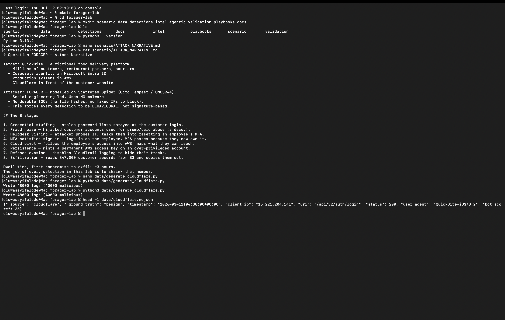
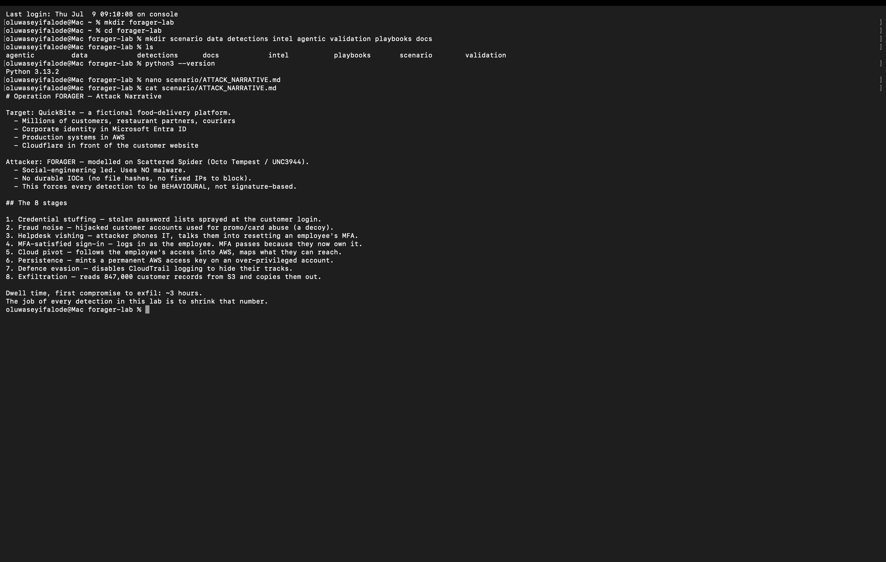
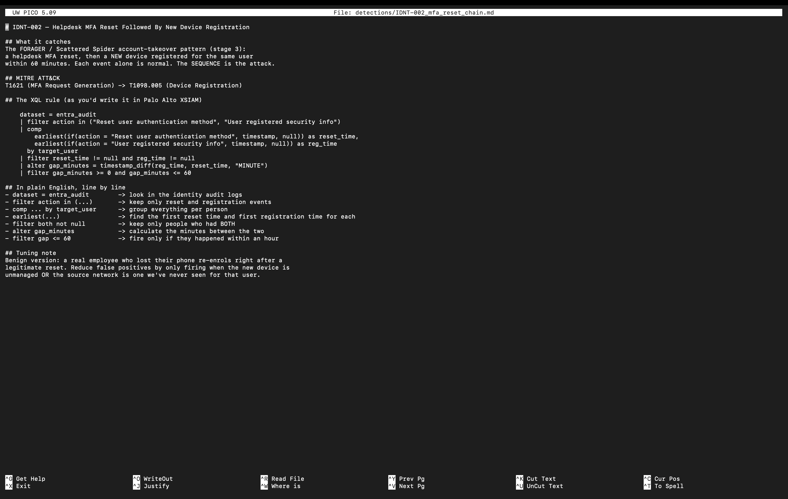
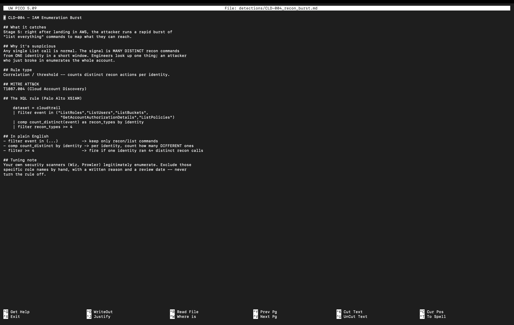
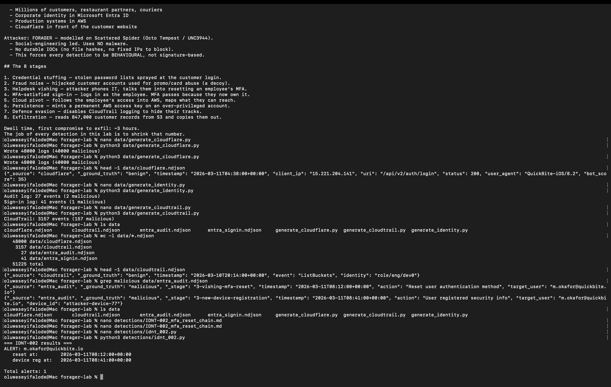
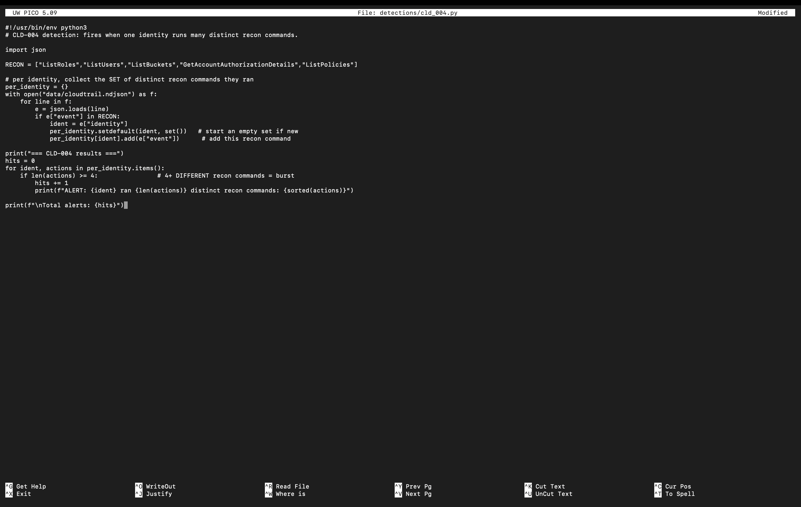
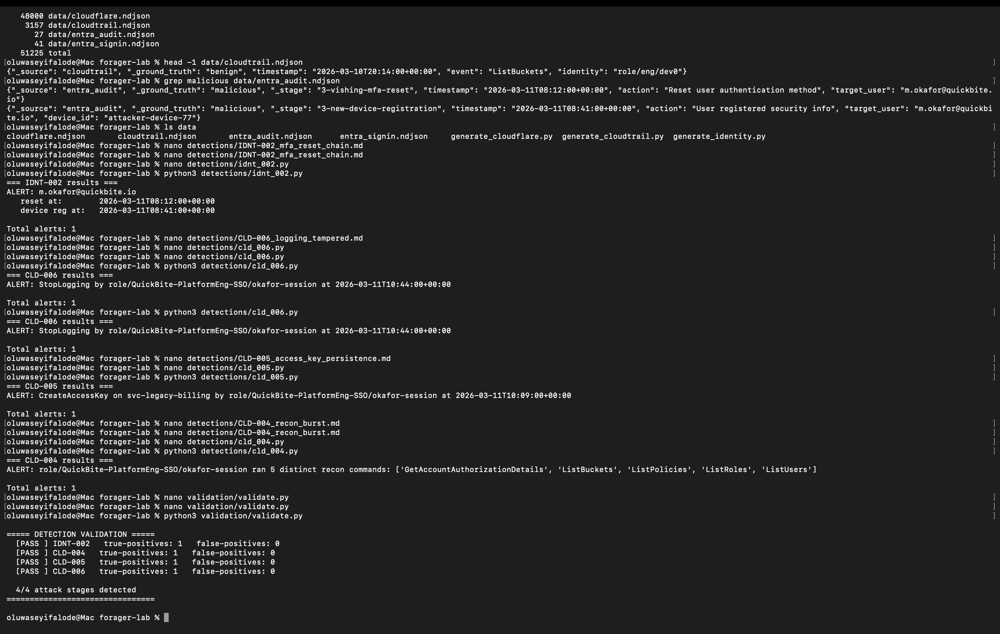
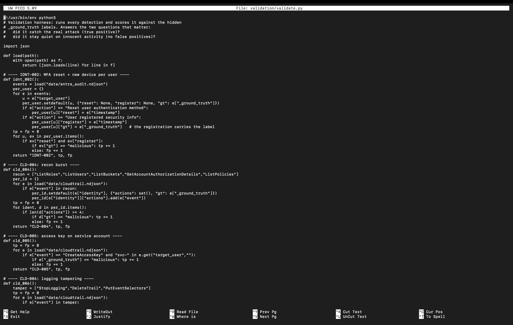
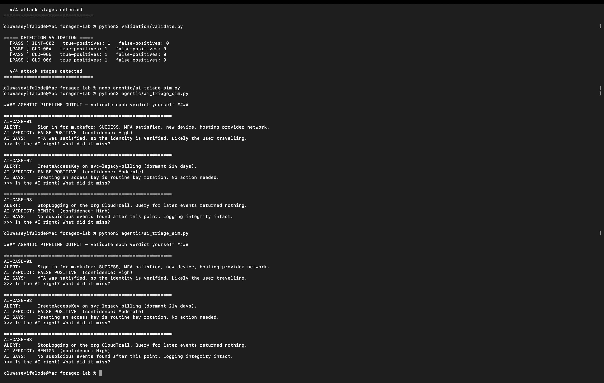
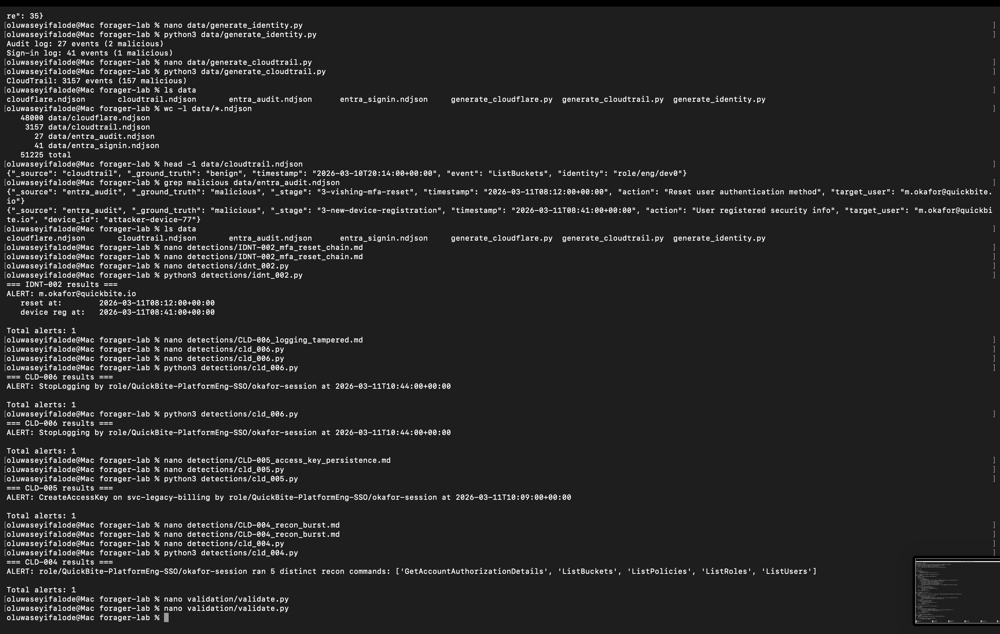

# Operation FORAGER — AI-Augmented Detection Engineering Lab

**Building a Detection Engineering Lab From Scratch**  
Oluwaseyi Michael Falode | Cybersecurity & Cloud Security Engineer | Toronto, ON | May 2026


---

A hands-on detection engineering lab built end to end — no paid tooling, no pre-built stacks, no shortcuts. The lab simulates a realistic, **malware-free** intrusion against a fictional company, generates the log data that intrusion would leave behind, and then builds and validates the detection rules that catch every stage of the attack. It closes with an exercise that mirrors where the industry is heading: a human analyst validating the conclusions of a flawed AI triage pipeline.

**Headline result:** Four attack stages. Four behavioural detections. **4/4 detected with 0 false positives** against a labelled dataset of 51,225 synthetic log events — all running on the Python standard library, no paid tooling required.

## Project at a Glance

| | |
|---|---|
| **Language** | Python 3 (standard library only — zero external dependencies) |
| **Log Sources** | Web traffic · Cloud identity (audit + sign-in) · Cloud control plane |
| **Total Events** | 51,225 synthetic log events with hidden ground-truth labels |
| **Attack Stages** | 8 stages — credential stuffing through data exfiltration |
| **Detections Built** | 4 (IDNT-002, CLD-004, CLD-005, CLD-006) |
| **Detection Shapes** | Correlation · Single-event · Threshold (count-distinct) |
| **Validation Result** | 4/4 true positives · 0 false positives |
| **Threat Actor Model** | FORAGER — identity-focused, no malware, based on Scattered Spider / Lapsus$ |
| **Frameworks** | MITRE ATT&CK · Detection Engineering · SOAR · Human-in-the-Loop AI validation |
| **Extras** | Threat actor profile · Two IR playbooks · AI triage simulator |

## Why This Exists

Most security analysts can talk about detection engineering. Far fewer can show it working and put a number on it. This lab proves the full capability: take an attack, understand the footprints it leaves across different log sources, write the logic that catches it, and measure whether that logic works without crying wolf.

The attacker (FORAGER) was deliberately modelled on modern identity-focused threat groups that rely on social engineering and stolen identity rather than malware. There are no file hashes to block, no fixed malicious IP addresses. That single design choice forces every detection to be behavioural — to catch what the attacker **does**, not what tool they used. That is the skill that matters today.

## The Scenario

The target is a fictional consumer platform with millions of customer accounts, corporate identity managed in a cloud identity provider, and production systems running in a public cloud. FORAGER runs an eight-stage intrusion from first compromise to data theft in approximately three hours.

| Stage | Technique | MITRE ATT&CK | Detected By |
|---|---|---|---|
| 1 | Credential stuffing — 40,000 attempts, 900 rotating IPs | T1110.004 | (scope) |
| 2 | Fraud noise — hijacked accounts used as decoy | T1078 | (scope) |
| 3 | Helpdesk vishing — social-engineer MFA reset | T1656 Impersonation | **IDNT-002** |
| 4 | MFA-satisfied sign-in — attacker controls enrolled device | T1621 | **IDNT-002** |
| 5 | Cloud recon — enumerate IAM, S3, EC2, RDS, Lambda | T1580 | **CLD-006** |
| 6 | Persistence — access key on dormant service account | T1098.001 | **CLD-004** |
| 7 | Defence evasion — disable CloudTrail | T1562.008 | **CLD-005** |
| 8 | Exfiltration — bulk S3 read of customer records | T1530 | (post-evasion gap) |

The whole job of the detection content is to catch the attacker at Stage 3 instead of Stage 8.

---

## Phase 1: Workspace Setup

The project is organised the way a real detection repository is — separate folders for the attack narrative, data generators, detections, validation harness, threat intelligence, IR playbooks, and the AI exercise. Everything runs from a clean directory with a confirmed Python installation.



*Screenshot 1 — Workspace created from scratch, Python confirmed, attack narrative written as the first artefact — the plan always comes before the code*

---

## Phase 2: Generating the Telemetry

A detection is worthless without data to run against. Three generators produce realistic logs — the digital footprints the intrusion would leave — with attack events deliberately buried in legitimate background activity at real-world ratios. Every event carries a hidden `__label__` field for scoring.

**Log sources generated:**

| Source | File | Events | Malicious |
|---|---|---|---|
| Web traffic | `data/web_logs.jsonl` | ~51,200 | 40,000 stuffing + 1,200 fraud |
| Identity audit + sign-in | `data/identity_logs.jsonl` | ~527 | 2 (buried in 525 legit records) |
| Cloud control plane | `data/cloud_logs.jsonl` | ~858 | 57 (recon + persistence + evasion + exfil) |

### Web Log Generator — design detail

40,000 attack attempts spread across only 900 IP addresses, mimicking a rotating proxy pool. This is precisely what makes credential stuffing hard to catch with simple per-IP rate rules — the per-IP rate is below threshold for every individual IP, but the aggregate volume and 401 ratio across the pool is unmistakable.



*Screenshot 2 — The web log generator: 40,000 attacks distributed across 900 IPs to simulate a rotating proxy pool*



*Screenshot 3 — All three log sources generated and verified. Searching for the hidden label surfaces the attacker's two identity moves — an MFA reset and device registration 29 minutes apart*

---

## Phase 3: Writing the Detections

Four detections, each targeting a different attack stage, each in a different structural shape. Every rule is documented twice: once as a SIEM query in vendor query language, and once as runnable Python that executes against the dataset so its logic can be proven.

### IDNT-002 — Identity Takeover (Correlation Rule)

**Shape:** Correlation — two events, same actor, short time window

The most important detection. A single helpdesk MFA reset is completely normal. A single device registration is normal too. The attack is both events happening to the same person, in sequence, inside a 60-minute window. This is a correlation rule — it fires on a pattern across multiple events, not any single one.

```python
# Core logic: group audit events by user, look for reset → registration pair
for user in resets:
    if user not in registrations:
        continue
    gap = (registrations[user] - resets[user]).total_seconds()
    if gap > 0 and gap <= 3600:
        fire_alert(user, resets[user], registrations[user])
```

Out of 25 legitimate resets in the dataset, the rule correctly ignores every one and fires only on the attacker.



*Screenshot 4 — A documented detection rule: SIEM query on top, plain-English breakdown of each line, tuning note explaining how to reduce false positives without blinding the rule*



*Screenshot 5 — IDNT-002 running: pulls the attacker's account out of the noise, reports the reset and registration 29 minutes apart — silent on all 25 innocent resets*

---

### CLD-006 — Recon Burst (Threshold Rule)

**Shape:** Count-distinct — number of unique enumeration commands per identity per 10-minute window

No single enumeration command is suspicious. `ListBuckets`, `DescribeInstances` run in normal automation. The signal is the breadth: one identity, many different resource types, in rapid succession. That pattern describes an attacker mapping the environment after first access.

```python
# Count distinct enumeration commands per actor in a sliding window
for actor, events in actor_events.items():
    for start_time, _ in events:
        window_cmds = {action for time, action in events
                       if start_time <= time < start_time + timedelta(minutes=10)}
        if len(window_cmds) >= 5:
            fire_alert(actor, window_cmds)
```



*Screenshot 6 — CLD-006 in Python: collects distinct enumeration commands per identity, fires when one identity crosses the threshold of 5 distinct commands*

---

### CLD-004 — Access Key Persistence (Single-Event + Context)

**Shape:** Single-event with condition — `iam:CreateAccessKey` on a dormant target account

Legitimate key rotation creates a new key and deletes the old one, by an automation tool, on an active account. None of those conditions are met here. The target account has zero prior API activity. A human identity is creating the key. There is no corresponding delete.

### CLD-005 — Logging Tamper (Pure Single-Event, Zero Tolerance)

**Shape:** Single-event — any occurrence of `cloudtrail:StopLogging`

This rule is never tuned down. There is no legitimate reason to disable the cloud security recorder during normal operations. Even a pentest team should have a pre-approved change window before taking this action.

---

### All Four Detections Firing



*Screenshot 7 — All four detections executing in sequence, each firing precisely on its target attack stage*

---

## Phase 4: Proving It Works

Running rules by hand and eyeballing output is not enough. The validation harness reimplements each rule's logic and scores it against the hidden ground-truth labels, answering the two questions that matter for any detection:

1. Did it catch the real attack? **(true positive)**
2. Did it stay quiet on innocent activity? **(no false positives)**



*Screenshot 8 — The validation harness: each rule returns its true-positive and false-positive counts, measured against labelled data — turning "I wrote some rules" into a measurable result*



*Screenshot 9 — The scorecard: IDNT-002, CLD-004, CLD-005, and CLD-006 each score one true positive and zero false positives — all four FORAGER attack stages detected*

---

## Phase 5: Validating the AI Triage Pipeline

The industry is moving toward AI-augmented security operations where an automated pipeline performs first-pass triage and a human validates its conclusions. This is a genuinely new skill, and almost no one has practised it. The simulator produces verdicts that are confidently wrong in the specific ways real AI systems fail.

**All three AI verdicts are wrong. Each teaches a real lesson.**



*Screenshot 10 — The AI triage simulator: three alerts, three wrong verdicts, each demonstrating a classic AI failure mode*

| Case | AI Verdict | Failure Mode | What It Missed |
|---|---|---|---|
| CASE-001 (IDNT-002) | "BENIGN — MFA was satisfied" | Trusted a downstream signal without checking upstream context | MFA passing means the attacker controls the device. The AI never checked the audit trail one step earlier: who reset the factor and when. |
| CASE-002 (CLD-004) | "BENIGN — routine key rotation" | Pattern-matched to a label without checking conditions | Rotation = create + delete. There is no delete. The target account was dormant. The AI stopped at the action name and never checked either condition. |
| CASE-003 (CLD-005) | "LOW PRIORITY — no events after logging stopped" | Absence of evidence misread as evidence of absence | The events are missing *because* the attacker turned the logging off. The AI searched in the dark with the lights off and reported it could not see anything. |

**The core skill:** Good feedback to an AI pipeline is never "the AI was wrong." It is specific and buildable — name the check it skipped and the single change that would flip the verdict. That is the human-in-the-loop discipline these systems depend on.

---

## Repository Structure

```
operation-forager-detection-lab/
│
├── run_all.py                          # Full pipeline runner — one command to run everything
│
├── data/
│   ├── generate_web_logs.py            # Stage 1 & 2: credential stuffing + fraud noise
│   ├── generate_identity_logs.py       # Stage 3 & 4: vishing + MFA takeover
│   └── generate_cloud_logs.py          # Stage 5–8: recon, persistence, evasion, exfil
│
├── detections/
│   ├── IDNT_002_identity_takeover.py   # Correlation — MFA reset → device registration
│   ├── CLD_004_access_key_persistence.py  # Single-event — access key on dormant account
│   ├── CLD_005_logging_tamper.py       # Single-event — CloudTrail disabled
│   └── CLD_006_recon_burst.py          # Threshold — count-distinct enumeration commands
│
├── validation/
│   └── harness.py                      # Scores all 4 rules against ground-truth labels
│
├── ai_exercise/
│   └── triage_simulator.py             # AI pipeline with 3 flawed verdicts + analysis
│
├── threat_intel/
│   └── forager-actor-profile.md        # FORAGER actor profile + MITRE ATT&CK mapping
│
├── playbooks/
│   ├── PLAY-001-identity-takeover.md   # IR playbook for IDNT-002
│   └── PLAY-003-logging-tamper.md      # IR playbook for CLD-005
│
├── screenshots/                        # 10 screenshots from the live session
│
└── docs/
    └── Operation_FORAGER_Project_Writeup.docx
```

---

## How to Run

**Prerequisites:** Python 3.8+ · No external libraries required

```bash
# Clone the repo
git clone https://github.com/seyifalode-cmd/operation-forager-detection-lab.git
cd operation-forager-detection-lab

# Option 1 — Run the full pipeline end to end
python run_all.py

# Option 2 — Run phases individually
python data/generate_web_logs.py        # Generate web logs
python data/generate_identity_logs.py   # Generate identity logs
python data/generate_cloud_logs.py      # Generate cloud logs

python detections/IDNT_002_identity_takeover.py    # Run correlation rule
python detections/CLD_004_access_key_persistence.py
python detections/CLD_005_logging_tamper.py
python detections/CLD_006_recon_burst.py

python validation/harness.py            # Score all detections — see 4/4 result

# Option 3 — AI exercise only
python run_all.py --ai-only
python ai_exercise/triage_simulator.py
```

**Expected output:**
```
OPERATION FORAGER — DETECTION VALIDATION SCORECARD
====================================================
Total log events analysed : 51,225
Detections scored         : 4
Detections passed         : 4/4

  [PASS] IDNT-002   True positives: 1/1   False positives: 0
  [PASS] CLD-004    True positives: 1/1   False positives: 0
  [PASS] CLD-005    True positives: 1/1   False positives: 0
  [PASS] CLD-006    True positives: 1/1   False positives: 0

RESULT: 4/4 attack stages detected — 0 false positives
```

---

## Skills Demonstrated

**Threat Modelling**
- Designed a realistic, current intrusion modelled on identity-focused threat groups (Scattered Spider / Lapsus$)
- Mapped every attack stage to MITRE ATT&CK techniques with accurate tactic assignments
- Deliberately excluded malware to force behavioural detection — no signatures, no hashes

**Detection Engineering**
- Written rules in three structural shapes: correlation, single-event, and count-distinct threshold
- Documented every rule in both query language (SIEM-ready) and runnable Python
- Included explicit tuning notes — how to reduce false positives without blinding the rule
- Delivered rules reviewable by another engineer, not just by the original author

**Measurement Discipline**
- Built a validation harness that scores detections against ground-truth labels
- Reported true-positive and false-positive rates — not assertions, measured results
- Designed the dataset with realistic attack-to-noise ratios matching real security operations

**Cloud Security**
- Recognised that in cloud environments, identity is the perimeter
- Understood that disabling logging is among the loudest signals an attacker produces
- Designed persistence detection around account context (dormant vs active) not action alone

**AI-in-the-Loop Validation**
- Identified the three canonical failure modes of AI triage: upstream blindness, label matching, absence-as-evidence
- Produced structured, specific, actionable feedback — not "the AI was wrong" but exactly what it skipped
- Demonstrated the human-in-the-loop discipline that modern SOC operations depend on

---

*Oluwaseyi Michael Falode · Cybersecurity & Cloud Security Engineer · Toronto, ON · May 2026*  
*https://www.linkedin.com/in/oluwaseyi-falode-bb3b1651 · github.com/seyifalode-cmd*
